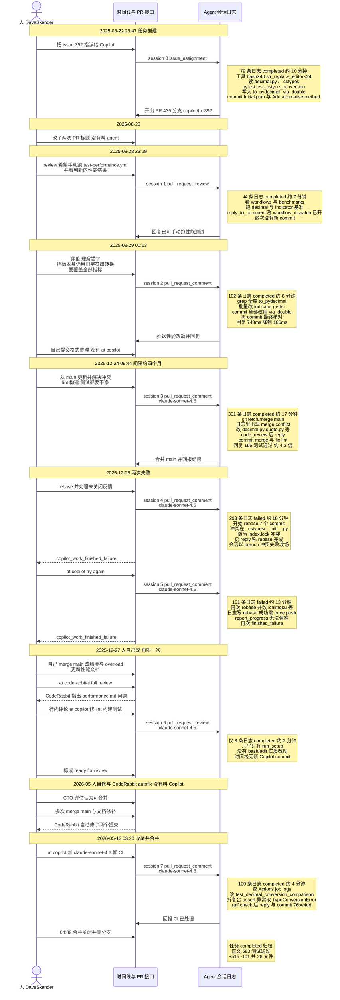

# 示例：facioquo/stock-indicators-python #439

第二阶段 4,146 条性能 PR 里，有 950 条能在 [AgentLogs](https://huggingface.co/datasets/risenlab/agentlogs)（发布版 `1.0-20261008`）的 `pull_requests` 表对上。这条是其中一条 Copilot，标题写的就是性能优化。

GitHub：<https://github.com/facioquo/stock-indicators-python/pull/439>

仓库里能看到的性能测试：`benchmarks/test_benchmark_indicators.py`、`benchmarks/test_decimal_conversion_performance.py`。

## 两边各记了什么

| | 第二阶段表 | AgentLogs `pull_requests` |
| --- | --- | --- |
| 身份 | `pr_id` = `3347093816`（AIDev 的 id，不是 GitHub PR id） | GitHub PR id = `2767784972` |
| 仓库 / 号 | `facioquo/stock-indicators-python` #439 | 同左 |
| 标题 | perf: Use 4x faster decimal conversion method across all indicators | 同左 |
| Agent | Copilot | 提交者 `copilot-swe-agent[bot]`，任务创建者 `daveskender` |
| 结局 | `open` | `closed`，已合并。合并者 `daveskender`，时间 2026-05-13 |
| 规模 | | +515 / −101，28 个文件 |
| 分支 | | `copilot/fix-392` → `main` |

第二阶段的 `open` 来自 AIDev 抽数时的状态。AgentLogs 里这条 PR 后来在 2026-05-13 合并了。DeepSeek 对标题和正文的判定是 `performance`（`deepseek-flash`，思考关掉）。

AgentLogs 正文是一份勾选清单：rebase 到 main、保留 `to_pydecimal_via_double`（大约 4 倍加速）、所有 indicator 的 getter 改用这个转换，并修了 lint 和测试。583 个测试通过。

## 文件

| 文件 | 内容 |
| --- | --- |
| `phase2_pr.json` | 第二阶段 `prs_performance_and_tests.csv` 的这一行，加上 `llm_labels.jsonl` 里最后一次成功判定 |
| `agentlogs_pull_request.json` | AgentLogs `pull_requests` 的整行 |
| `agentlogs_tasks.json` | 指向这条 PR 的 `agent_tasks` |
| `agentlogs_sessions.json` | 指向这条 PR 的 `agent_sessions` 整行 |
| `sessions_readable.json` | 上面 8 个会话抽出来的名字、模型、状态和报错 |
| `agentlogs_session_logs.json` | AgentLogs `agent_session_logs`：8 次会话的逐条运行日志（1108 行） |
| `agentlogs_session_logs_readable.json` | 上面日志的精简版：角色、工具名、命令、路径、报错预览 |
| `agentlogs_workflow_runs.json` | 跑这 8 次会话的 GitHub Actions `workflow_runs` |
| `agentlogs_pull_request_timeline.json` | AgentLogs 自己收的 PR 时间线（105 个事件） |
| `agentlogs_repository.json` | AgentLogs `repositories` 里这个仓库的一行 |
| `agentlogs_users.json` | 相关用户（`daveskender`、`copilot-swe-agent[bot]`），只保留和本例有关的反向链接 |
| `aidev_pull_request.json` | AIDev-7.6M `pull_request` 主表这一行 |
| `aidev_repository.json` | `repository` 里这个仓库的一行 |
| `aidev_pr_commits.json` | `pr_commits`，11 个 commit |
| `aidev_pr_commit_details.json` | `pr_commit_details`，218 行，含每个文件的 `patch` |
| `aidev_pr_reviews.json` | `pr_reviews`，6 条 |
| `aidev_pr_review_comments.json` | `pr_review_comments`，17 条行内评论 |
| `aidev_pr_comments.json` | `pr_comments`，12 条 |
| `aidev_pr_timeline.json` | AIDev `pr_timeline`，104 个事件 |
| `aidev_related_issue.json` | `related_issue`，这条 PR 没有关联 issue，所以是空数组 |

## AIDev-7.6M

这些行都按 `pr_id = 3347093816` 从 [AIDev-7.6M](https://huggingface.co/datasets/hao-li/AIDev-7.6M) 抽出来。7.6M 没有 `pr_task_type` 这张表。`related_issue` 是空的，所以没有再去 `issue` 表里找。

主表 `pull_request` 里这条还是 `open`，`merged_at` 为空。`pr_timeline` 里已经有 `merged` 和 `closed` 各 1 次。文件级 diff 在 `aidev_pr_commit_details.json`：11 个 commit、176 个路径、218 行变更（modified 194、added 20、removed 2）。其中性能测试相关的包括新增 `benchmarks/test_decimal_conversion_performance.py`，以及修改 `benchmarks/test_benchmark_indicators.py`、`.github/workflows/test-performance.yml`、`docs/pages/performance.md`。

## AgentLogs 里的任务和会话

一条任务：`cb4388d7-fc41-40f7-81f7-80c5f782598b`，状态 `completed`，已归档。协作者 slug 是 `copilot-developer`。下面 8 个会话都有 `log_found = true`。会话上的 `prompt` 和多数 `model` 是空的；逐条运行日志已抽到 `agentlogs_session_logs.json`（1108 行），可读摘要在 `agentlogs_session_logs_readable.json`。

| # | 时间 (UTC) | 会话名 | 状态 | 模型 | 触发 |
| ---: | --- | --- | --- | --- | --- |
| 0 | 2025-08-22 23:47 | Initial implementation | completed | | issue_assignment |
| 1 | 2025-08-28 23:29 | Review from @DaveSkender | completed | | pull_request_review |
| 2 | 2025-08-29 00:13 | Review from @DaveSkender | completed | | pull_request_comment |
| 3 | 2025-12-24 09:45 | Improving performance with new decimal conversion method | completed | claude-sonnet-4.5 | pull_request_comment |
| 4 | 2025-12-26 03:28 | Implementing faster decimal conversion method for indicators | failed | claude-sonnet-4.5 | pull_request_comment |
| 5 | 2025-12-26 04:21 | Enhancing performance of decimal conversion methods | failed | claude-sonnet-4.5 | pull_request_comment |
| 6 | 2025-12-27 10:07 | Enhancing decimal conversion performance across indicators | completed | claude-sonnet-4.5 | pull_request_review |
| 7 | 2026-05-13 03:20 | Improving decimal conversion performance across all indicators | completed | claude-sonnet-4.6 | pull_request_comment |

第 4、5 次失败的原因相同：Copilot 还在改的时候，分支上又被推了新提交，它没能把自己的改动和远端分支合上。

## 人机交互时间线（含会话日志）

中间是 PR / Agent 接口时间线；左侧是人的动作；右侧是会话元数据加上 `agent_session_logs` 里实际跑过的工具与结果。时间 UTC。8 次会话合计 1108 条日志。

